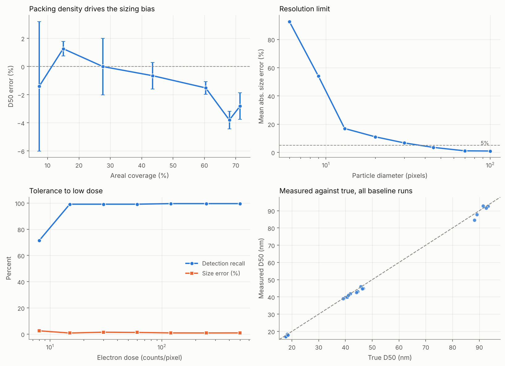

# NanoMetrix

**Automated nanoparticle size and shape metrology from electron micrographs.**

Measures the particle size distribution in an SEM or TEM image automatically,
including reading the instrument's own scale bar so results come back in
nanometres rather than pixels.

---

## The problem

Particle size distribution is the single most important characterisation
metric for any nanomaterial. It controls catalytic activity, optical
response, cellular uptake, sintering behaviour and toxicity — the reason a
20 nm particle behaves differently from the same mass of bulk powder is that
surface area per gram scales as 1/d.

In most labs it is still measured by hand. A researcher opens a micrograph in
ImageJ and clicks across particles one at a time. The procedure is slow
(hundreds of particles per image for decent statistics), subjective, and not
reproducible — two people measuring the same image get different numbers,
and so does the same person on a different day.

NanoMetrix automates the whole path from image to reportable statistics.

## What it does

1. **Finds and reads the scale bar** by OCR, converting pixels to nanometres.
   This is the part that makes it a measurement rather than a picture: a
   diameter in pixels is not a length, since the same particle imaged at two
   magnifications would get two different "sizes".
2. **Segments individual particles**, separating ones that touch — which is
   the hard part, not an afterthought (see below).
3. **Measures each particle**: equivalent circular diameter, Feret diameter,
   circularity, aspect ratio, solidity, eccentricity.
4. **Fits the population**: log-normal median and GSD, D10/D50/D90, Sauter
   mean D[3,2], De Brouckere mean D[4,3], polydispersity index, and a
   bootstrap confidence interval on the median.
5. **Estimates specific surface area** from D[3,2] and the bulk density.
6. **Exports** a per-particle CSV, an annotated overlay, and distribution plots.

### Why separating touching particles is the whole game

Thresholding a micrograph is easy, and on a sparse sample that is the entire
job. Real samples are not sparse: particles dry into contact, and every
touching pair becomes one connected blob. A blob of two 40 nm spheres has the
area of a single 57 nm sphere — so naive thresholding does not merely
miscount, it invents a large-particle tail that was never in the sample and
drags the reported mean upward. A distance-transform watershed splits those
contacts, and the validation below quantifies exactly how well.

Particles clipped by the frame edge are discarded, following standard
stereological practice: only part of such a particle is visible, so measuring
it reports a diameter smaller than the truth, and since larger particles are
likelier to touch an edge the bias falls on the whole distribution.

## Install and run

```bash
pip install -r requirements.txt
sudo apt install tesseract-ocr        # needed for scale-bar OCR
```

```bash
python cli.py --demo                              # generate and analyse
python cli.py samples/sem_au_40nm.png --material Au
python cli.py samples/ --outdir outputs --csv all.csv --material Au
python cli.py image.tif --nm-per-px 0.37          # skip OCR
streamlit run app.py                              # web interface
python validate.py                                # reproduce the results below
```

As a library:

```python
from nanometrix import analyze
from PIL import Image
import numpy as np

result = analyze(np.array(Image.open("micrograph.png").convert("L")),
                 material="Au")
print(result.report())
result.particles.to_csv("particles.csv", index=False)
```

## Validation

The tool is graded against a **synthetic ground truth**, because real
micrographs have no true answer — the "ground truth" in published datasets is
itself a human with a mouse, and agreeing with it would only prove the tool
reproduces a human's bias. So the problem is inverted: `synth.py` renders
micrographs from diameters *we chose*, applying the degradations a real
instrument imposes (Poisson shot noise, probe blur, illumination gradient,
vignetting, a burnt-in scale bar), and the pipeline is asked to recover the
numbers it started from.

The generator models physics rather than appearance: a log-normal size
population (nucleation-and-growth is multiplicative, so ln d is what adds up),
SEM rim brightening from secondary-electron yield at tilted surfaces, and TEM
mass-thickness contrast as *exponential* attenuation, I = I₀exp(−t/λ).

**Baseline accuracy** — 20 images, SEM and TEM, ~40% areal coverage:

| Metric | Result |
|---|---|
| Scale bar read correctly | 100% of images, 0.18% mean calibration error |
| Detection recall | 99.1% |
| Detection precision | 98.1% |
| Per-particle size error | 1.60% (mean absolute) |
| Population D50 error | 2.05% (mean absolute) |
| True vs measured D50 | r = 0.9993 |

**Packing density** — the dominant error source, and the reason the watershed
stage exists:

| Coverage | Recall | D50 error |
|---|---|---|
| 7% | 100% | −1.4% |
| 28% | 98.2% | −0.0% |
| 44% | 99.2% | −0.7% |
| 60% | 97.9% | −1.5% |
| 68% | 91.6% | −3.8% |
| 71% | 89.9% | −2.8% |

Accuracy holds to about 60% coverage. Beyond that, watershed cuts particles
at their contact necks and the measured diameter drifts low — so dilute the
sample rather than trusting a crowded image.

**Spatial resolution** — how few pixels a particle can span:

| Diameter (px) | Size error |
|---|---|
| 13 | 16.9% |
| 20 | 11.0% |
| 30 | 6.7% |
| 45 | 3.5% |
| 70 | 1.1% |
| 100 | 1.0% |

**Image particles at ≥45 px across for better than 5% accuracy**; below about
20 px, blur comparable to the particle itself inflates every diameter.

**Electron dose** — detection stays above 99% down to 15 counts/pixel and
collapses at 8, so low-dose imaging of beam-sensitive samples is viable.

**Boundary criterion** — two methods were implemented and compared rather than
assumed. Re-cutting each particle at its own half-maximum intensity is the
textbook convention for a blurred edge, but measured against ground truth it
*lost* to a global Otsu threshold (1.85% vs 1.37% size error; circularity
0.886 vs 0.944). The reason is specific: the half-max rule assumes a
flat-topped intensity profile, but an SEM particle's brightest pixels are its
rim, not its centre, so the "interior level" the rule needs is systematically
wrong. It remains available via `--refine`, defaulted off.



## Repository layout

```
nanometrix/
  synth.py          physics-based micrograph generator with exact ground truth
  calibration.py    scale-bar detection, OCR with majority voting, nm/px
  segmentation.py   CLAHE, denoise, polarity, Otsu, watershed, border rejection
  metrics.py        per-particle descriptors, log-normal fit, D32/D43, SSA
  viz.py            annotated overlay, size distribution, shape plots
  pipeline.py       end-to-end orchestration
cli.py              batch command line
app.py              Streamlit web interface
validate.py         the ground-truth experiments above
samples/            synthetic micrographs + ground_truth.json
```

## Engineering notes

Three bugs found by validation that would not have surfaced otherwise, each
of which silently produced plausible-looking wrong answers:

- **Polarity detection by histogram mode** inverted on exactly the images the
  tool targets. Strongly scattering particles saturate, so their interiors
  pile into one tall histogram spike while the background's shot noise
  spreads across many bins — making the particles the mode. The background
  was then segmented as a single enormous particle and every real particle
  discarded. Replaced with a topological test: background is one connected
  sheet, particles are many separate blobs, so the more fragmented phase is
  the particles.
- **Single-pass OCR silently doubled the scale.** "100 nm" read as "200 nm"
  is a clean factor-of-two error in every size reported afterwards, with
  nothing downstream to catch it, because 200 nm is just as plausible a bar
  as 100 nm. Fixed by running several independent preprocessings and taking
  the majority; vote agreement now feeds the reported confidence.
- **Half-max refinement thresholded the raw image**, so shot noise straddling
  the level flipped pixels independently and produced ragged boundaries,
  which both wrecked the shape descriptors and biased diameters low.

Known limits: particles must be roughly convex for watershed to split them
correctly; heavy aggregates are reported as single objects and flagged by low
circularity rather than silently measured; the half-max option underperforms
the default; and OCR needs a scale bar with a legible burnt-in label, falling
back to pixel units with a warning when none is found.

### Input validation

`analyze()` takes an already-decoded array, not a file path, so "corrupt
image" isn't a decode error at that layer -- it's a malformed array reaching
the pipeline. Before validation was added, each of the following failed
several calls deep with an opaque, implementation-specific error instead of
a message naming the problem: `None` or a non-array (`AttributeError:
'NoneType' object has no attribute 'ndim'`), a 1-D array (an OpenCV
"Invalid number of channels" assertion from the internal RGB-to-grayscale
conversion), an empty array (an OpenCV `!_src.empty()` assertion from
`morphologyEx`), and a NaN-filled float array (silently cast to garbage
`uint8` values with only a `RuntimeWarning`, no error at all). `analyze()`
now checks the array's type, dimensionality, shape and dtype up front and
raises a `ValueError` describing exactly what's wrong.

The file-loading helpers (`nanometrix.io.load_grayscale`, used by both
`cli.py` and `app.py`) have the matching fix one layer up: a truncated or
unidentifiable file used to propagate PIL's own exception
(`UnidentifiedImageError`, or a bare `OSError("Truncated File Read")`,
triggered lazily by `Image.load()`/`np.asarray()` rather than by
`Image.open()` itself) as a raw traceback. It's now caught and re-raised as
a `ValueError` naming the file, and the CLI skips a bad file in a batch
rather than aborting the whole run.

### Static typing

`metrics.py` and `viz.py` are fully type-hinted on their public functions and
pass `mypy --ignore-missing-imports --follow-imports=silent` with zero
issues. Getting there found one real latent bug: `measure_particles()`
computed its pixel-to-nanometre scale factor as
`float(nm_per_px) if calibrated else 1.0`, where `calibrated` is a *separate*
boolean that happens to imply `nm_per_px is not None` -- true at runtime, but
invisible to a type checker, which flagged passing an `Optional[float]` to
`float()`. Harmless in practice (the branch is never taken with `None`), but
the kind of thing that stops being harmless the next time someone edits the
surrounding logic. Fixed by making the `is not None` check part of the
condition itself, so the narrowing is explicit rather than implied.

Running `mypy` over the rest of the package (`nanometrix/`) surfaces five
pre-existing errors confined to `synth.py` (an `Optional` default on a
non-optional dataclass field, two assignment-type mismatches, and a tuple
passed where `cv2.GaussianBlur` wants a kernel-size sequence) -- all in
synthetic-micrograph generation used for testing and validation, not in the
measurement path. They're out of scope for this pass; tracked as a backlog
item.

## Possible extensions

Swap the classical segmenter for a U-Net or SAM-based one and re-run
`validate.py` unchanged — the harness is model-agnostic, so the comparison is
apples to apples. Other directions: 3D size from tilt series, automatic
aggregate classification, and validation against the public NFFA-EUROPE SEM
dataset (~21,000 annotated nanoscience micrographs).
